# Advanced C# Lab Assignment
## Sharaxaadda Afarta Assignment

README-kan wuxuu sharxayaa afarta assignment ee C# Windows Forms. Assignment kasta wuxuu leeyahay ujeeddo, shuruudo, xisaabinta lacagta, validation, iyo shaqada badhamada.

---

# 1. Hotel Booking System

## Ujeeddada
In la sameeyo barnaamij lagu qabsado qolalka hoteelka, laguna xisaabiyo qiimaha qolka, discount-ka, quraacda iyo lacagta guud.

## Xogta laga rabo user-ka
- Guest Name: Magaca qofka qabsanaya qolka.
- Age: Da'da qofka.
- Number of Nights: Tirada habeenada.
- Number of Guests: Tirada dadka.
- Room Type: Nooca qolka.
- Breakfast: In quraac la rabo iyo in kale.

## Shuruudaha (Validation)
- Magaca martida waa inuu buuxsanaadaa.
- Da'du waa inay u dhexaysaa 18 ilaa 90.
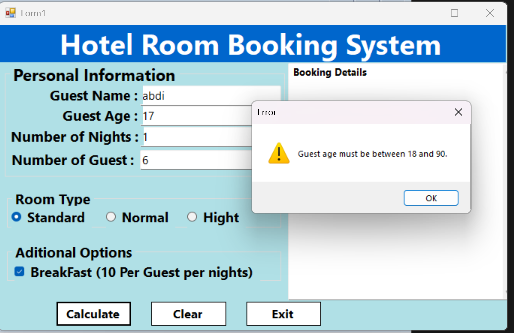
- Habeenadu waa inay u dhexeeyaan 1 ilaa 30.
- Tirada martidu waa inay u dhexaysaa 1 ilaa 6.
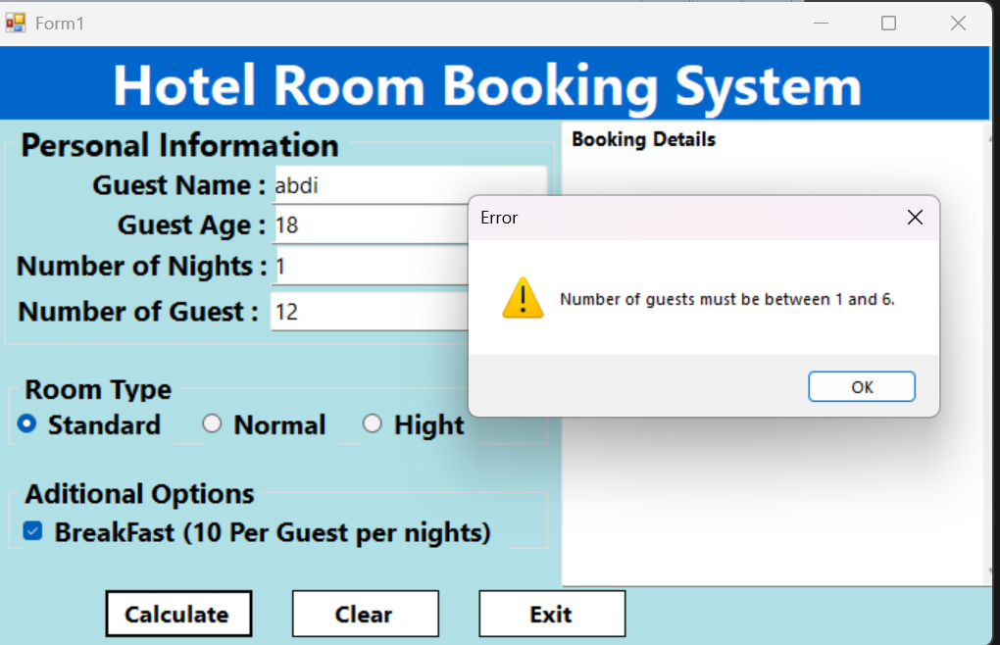
- Standard Room wuxuu qaadi karaa ugu badnaan 2 qof.
- Deluxe Room wuxuu qaadi karaa ugu badnaan 4 qof.
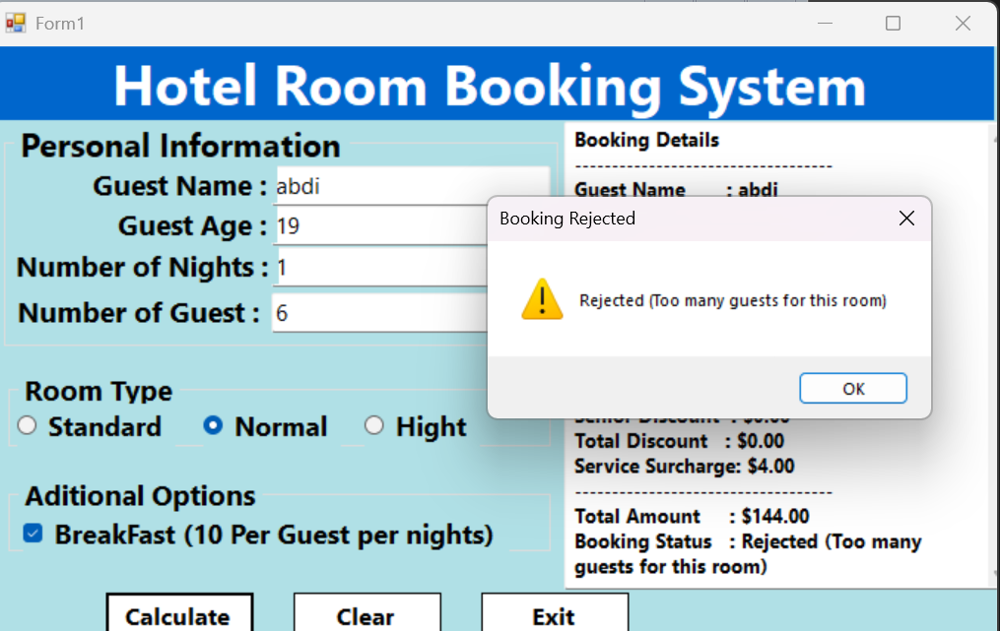

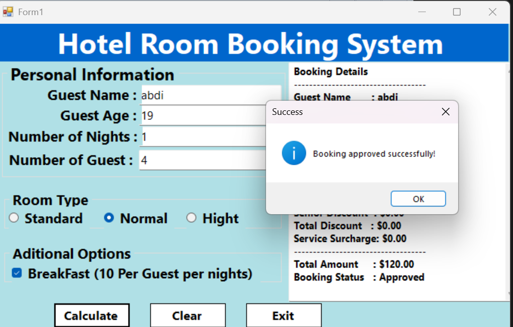
- Suite Room wuxuu qaadi karaa ugu badnaan 6 qof.
- Waxaa la isticmaalayaa `bool bookingApproved` si loo ogaado in booking-ka la aqbalay ama la diiday.

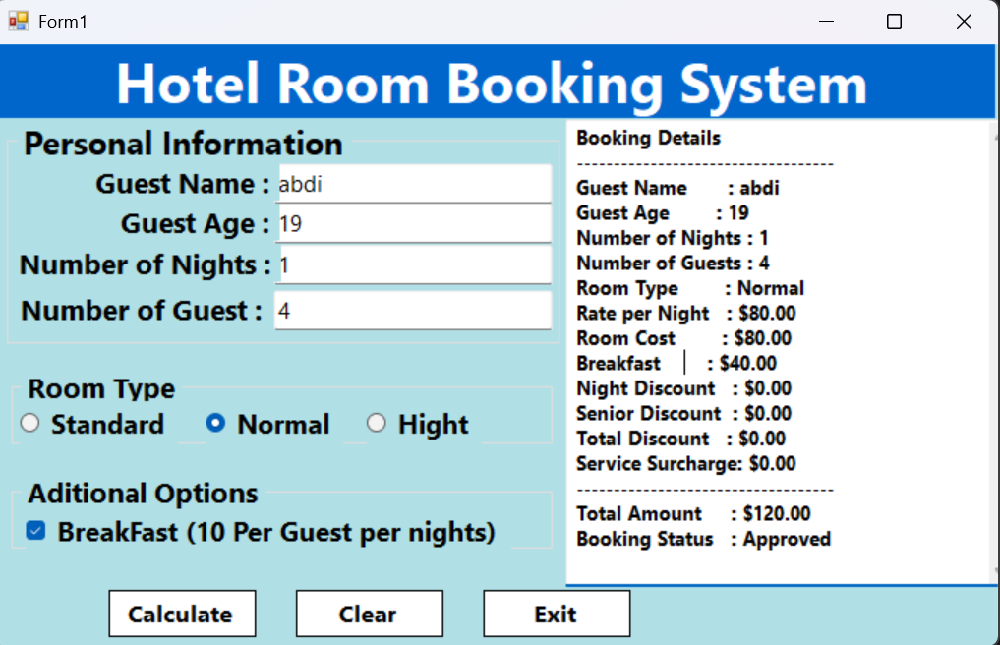

## Qiimaha qolalka
| Room Type | Qiimaha Habeenkii |
|---|---:|
| Standard | $50 |
| Normal | $80 |
| Hight | $130 |

**Fiiro gaar ah:** Assignment-ka asalka ah wuxuu qiimaha ku magacaabay Standard, Normal iyo Hight, laakiin xeerarka tirada dadka wuxuu adeegsaday Standard, Deluxe iyo Suite. Magacyadan waa in la waafajiyaa marka design-ka la diyaarinayo.

## Discount-ka
- 1 ilaa 4 habeen: Discount ma jiro.
- 5 ilaa 9 habeen: 5% discount.
- 10 habeen ama ka badan: 12% discount.
- Da'da 60 ama ka badan: 5% senior discount oo dheeraad ah.

## Kharashaadka dheeraadka ah
- Quraacda: $10 qofkiiba habeenkii.
- Haddii martidu ka badan yihiin 4 qof: 5% service surcharge.

## Xisaabinta
- Room Cost = Room Rate × Number of Nights
- Breakfast Cost = $10 × Number of Guests × Number of Nights
- Discount = Room Cost × Discount Percentage
- Total = Room Cost − Discount + Breakfast Cost + Service Surcharge − Senior Discount

Senior discount-ka iyo service surcharge-ka waa in loo xisaabiyaa si waafaqsan habka assignment-ka loo hirgelinayo.

## Badhamada
- **Calculate:** Wuxuu hubinayaa xogta, xisaabinayaa kharashka, kadibna soo bandhigayaa natiijada.
- **Clear:** Wuxuu nadiifinayaa dhammaan meelaha xogta laga geliyo.
- **Exit:** Wuxuu xirayaa barnaamijka.

## Waxyaabaha C# ee la adeegsanayo
- Variables iyo data types.
- `TryParse()` si loo hubiyo xogta tirooyinka.
- `if`, `else if`, iyo `else`.
- `switch` si loo doorto qiimaha qolka.
- Logical operators sida `&&` iyo `||`.
- `bool bookingApproved`.
- Currency formatting si lacagta loogu muujiyo qaab sax ah.

---

# 2. Passenger Ticket Booking System

## Ujeeddada
In la sameeyo barnaamij lagu qabsado tigidhada safarka, laguna xisaabiyo qiimaha tigidhada, discount-ka, insurance-ka iyo xaaladda booking-ka.

## Xogta laga rabo user-ka
- Passenger Age: Da'da rakaabka.
- Number of Tickets: Tirada tigidhada.
- Baggage Weight: Miisaanka boorsooyinka.
- Ticket Class: Nooca tigidhka, sida First Class.
- Ticket Price: Qiimaha tigidhka.

## Shuruudaha (Validation)
- Da'du waa inay u dhexaysaa 1 ilaa 100.
- Tirada tigidhadu waa inay u dhexaysaa 1 ilaa 5.
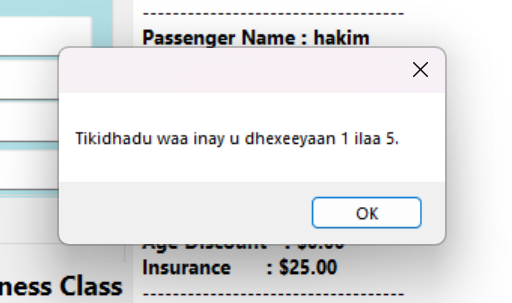
- Miisaanka boorsadu ma noqon karo tiro taban.
- Miisaanka boorsadu waa inuusan ka badnaan 50 kg qofkiiba.
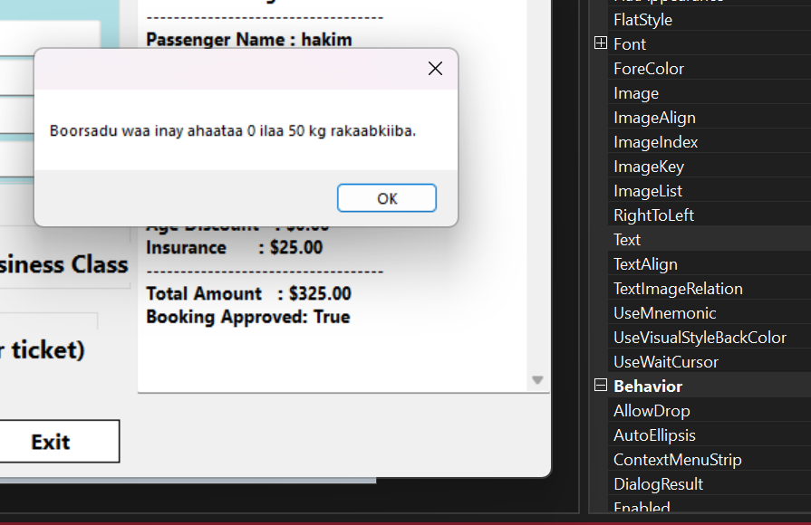
- Carruurta ka yar 12 sano looma oggola inay qabsadaan First Class.
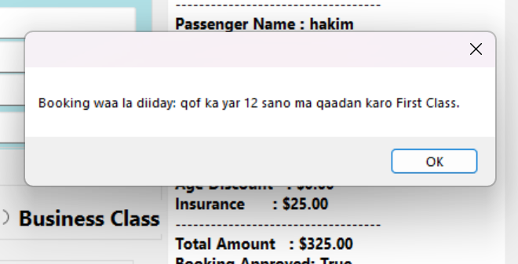

- Haddii qof ka yar 12 sano doorto First Class, booking-ka waa in la diido.

- Waxaa la isticmaalayaa `TryParse()` si xogta tirooyinka loo hubiyo.
- Waxaa la isticmaalayaa `bool bookingApproved` si loo ogaado in booking-ka la aqbalay ama la diiday.
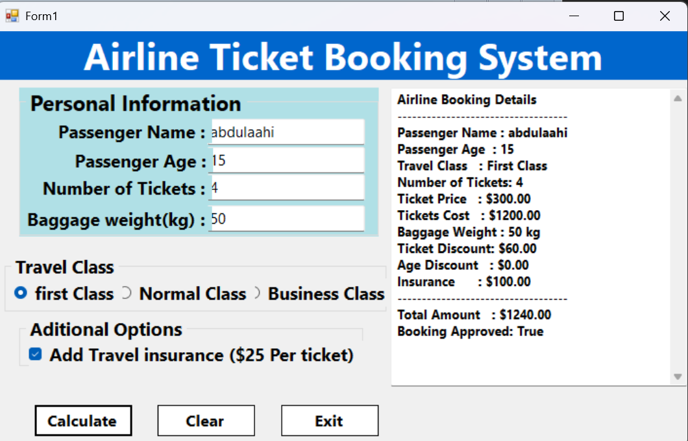
- Haddii booking-ka la diido, waa in la muujiyaa sababta.

## Xisaabinta qiimaha
- Basic Ticket Cost = Ticket Price × Number of Tickets.

## Discount-ka tigidhada
- 1 ilaa 2 tigidh: Discount ma jiro.
- 3 ilaa 4 tigidh: 5% discount.
- 5 tigidh: 10% discount.
- Da'da ka yar 12 sano: 20% child discount.
- Da'da 60 ama ka badan: 10% senior discount.

## Insurance iyo boorsooyinka
- Insurance: $25 tigidhkiiba.
- Boorsooyinka ilaa 20 kg qofkiiba waa bilaash.
- Miisaanka boorsooyinka waa inuusan ka badnaan 50 kg qofkiiba.

Assignment-ku ma qeexayo qiime dheeraad ah oo lagu qaadayo boorsooyinka ka badan 20 kg. Sidaas darteed qiime dheeraad ah lama samaynayo ilaa macallinku bixiyo xeer kale.

## Xisaabinta guud
- Basic Ticket Cost = Ticket Price × Number of Tickets
- Ticket Discount = Basic Ticket Cost × Discount Percentage
- Insurance Cost = $25 × Number of Tickets
- Final Cost = Basic Ticket Cost − Discount + Insurance Cost

Haddii child discount iyo senior discount labaduba khuseeyaan, waa in si cad loo go'aamiyaa sida loo adeegsanayo; assignment-ka la bixiyey ma faahfaahinayo in la isku darayo iyo in kale.

## Badhamada
- **Book/Calculate:** Wuxuu hubinayaa xogta, qiimeynayaa shuruudaha, kadibna xisaabinayaa lacagta.
- **Clear:** Wuxuu nadiifinayaa xogta la geliyey.
- **Exit:** Wuxuu xirayaa barnaamijka.

## Waxyaabaha C# ee la adeegsanayo
- `int`, `double`, `string` iyo `bool`.
- `TryParse()`.
- `if`, `else if`, iyo `else`.
- Logical operators.
- Nested `if` statements.
- `bool bookingApproved`.
- Currency formatting.
- Validation iyo muujinta sababta booking-ka loo diiday.

---

# 3. Vehicle Rental System

## Ujeeddada
In la sameeyo barnaamij lagu kireeyo gaadiid, laguna xisaabiyo kirada, discount-ka, insurance-ka iyo kharashaadka dheeraadka ah.

## Xogta laga rabo user-ka
- Customer Name: Magaca macmiilka.
- Age: Da'da macmiilka.
- Rental Days: Tirada maalmaha gaadhiga la kiraysanayo.
- Driving Experience: Sanadaha khibradda wadista.
- Vehicle Type: Economy, SUV ama Luxury.
- Insurance: In insurance la rabo iyo in kale.

## Shuruudaha (Validation)
- Magaca macmiilka waa inuu buuxsanaadaa.
- Da'du waa inay u dhexaysaa 18 ilaa 80.
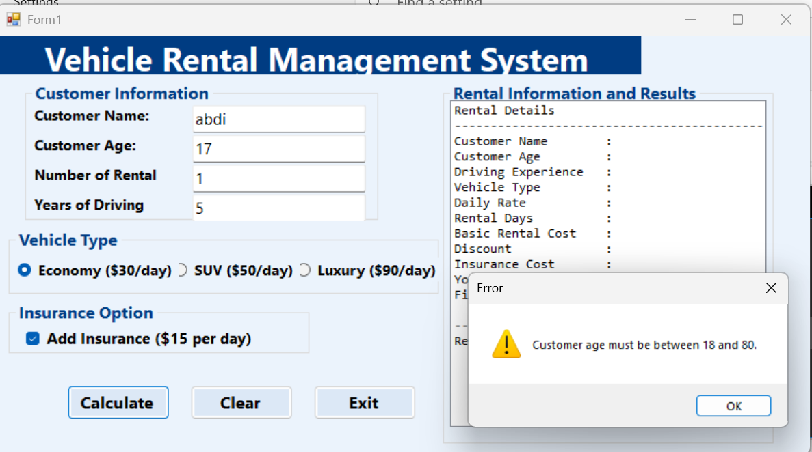
- Maalmaha kiradu waa inay u dhexeeyaan 1 ilaa 30.
- Driving experience-ku ma noqon karo tiro taban.
- Qofka ka yar 21 sano uma qalmo kirada.
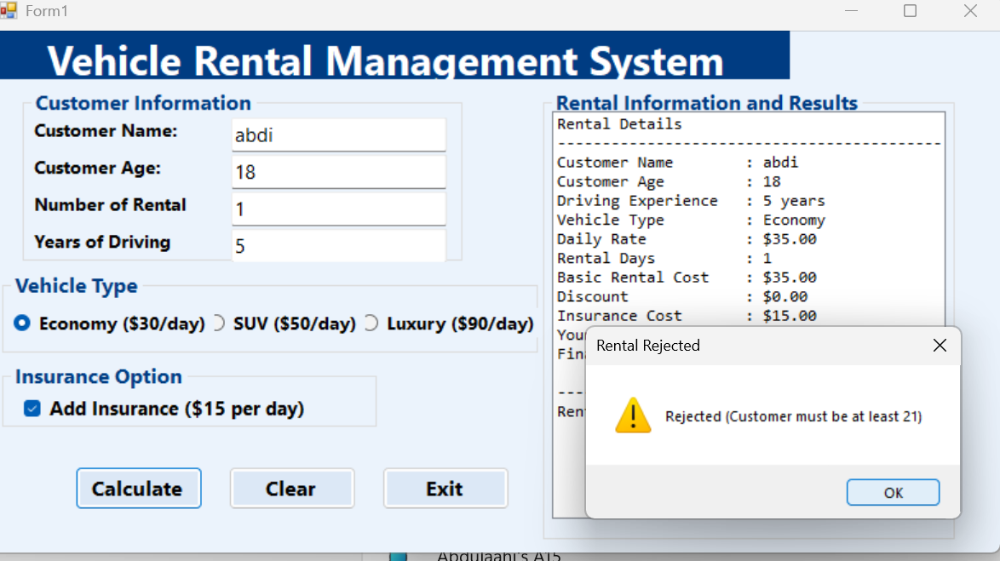
- Macmiilku waa inuu leeyahay ugu yaraan hal sano oo khibrad wadis ah.
- Luxury waxaa kaliya kiraysan kara qof jira ugu yaraan 25 sano oo leh ugu yaraan 3 sano oo khibrad wadis ah.
- Waxaa la isticmaalayaa `bool bookingApproved` si loo ogaado in kirada la aqbalay ama la diiday.
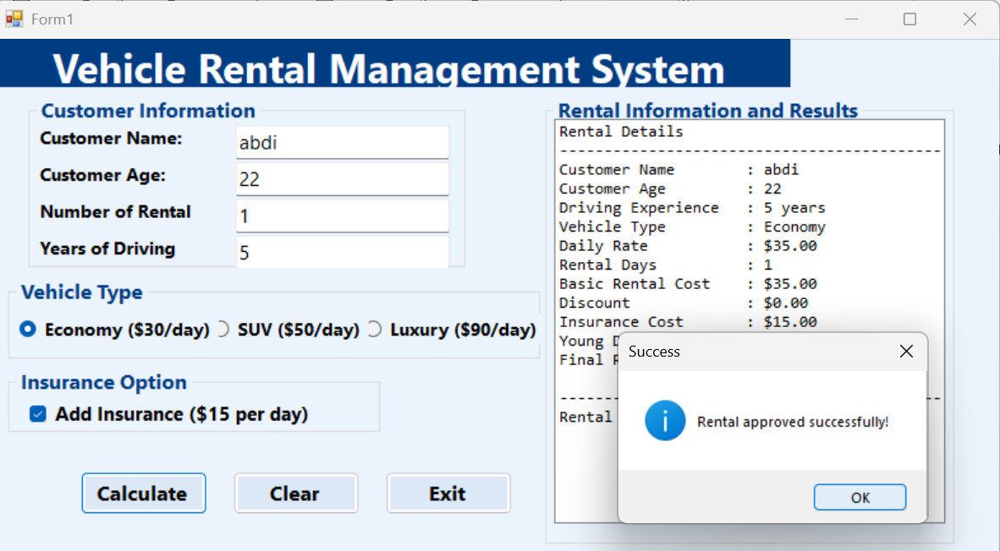

## Qiimaha kirada
| Vehicle Type | Qiimaha Maalintii |
|---|---:|
| Economy | $35 |
| SUV | $60 |
| Luxury | $100 |

## Discount-ka
- 1 ilaa 6 maalmood: Discount ma jiro.
- 7 ilaa 13 maalmood: 5% discount.
- 14 maalmood ama ka badan: 10% discount.

## Kharashaadka dheeraadka ah
- Insurance: $15 maalintii haddii la doorto.
- Da'da 21 ilaa 24 sano: 10% young driver surcharge.

## Xisaabinta
- Basic Rental Cost = Daily Rate × Rental Days
- Discount = Basic Rental Cost × Discount Percentage
- Insurance Cost = $15 × Rental Days, haddii insurance la doorto.
- Young Driver Surcharge = Basic Rental Cost × 10%, haddii da'du u dhexayso 21 iyo 24.
- Final Cost = Basic Rental Cost − Discount + Insurance Cost + Young Driver Surcharge.

## Badhamada
- **Calculate:** Wuxuu hubinayaa xogta, go'aaminayaa in macmiilku u qalmo, kadibna xisaabinayaa kirada.
- **Clear:** Wuxuu nadiifinayaa dhammaan xogta, wuxuuna dib u dejinayaa RadioButtons iyo CheckBox-ka.
- **Exit:** Wuxuu xirayaa barnaamijka.

## Waxyaabaha natiijada lagu muujinayo
- Customer Name.
- Vehicle Type.
- Basic Rental Cost.
- Discount.
- Insurance Cost.
- Young Driver Surcharge, haddii uu jiro.
- Final Rental Cost.
- Booking Status.

## Waxyaabaha C# ee la adeegsanayo
- Variables iyo data types.
- `TryParse()`.
- `if`, `else if`, iyo `else`.
- `switch` ama RadioButtons si loo doorto gaadhiga.
- Logical operators.
- `bool bookingApproved`.
- Currency formatting.
- Event handlers sida `btnCalculate_Click`, `btnClear_Click` iyo `btnExit_Click`.

---

# 4. Course Registration System

## Ujeeddada
In la sameeyo barnaamij lagu diiwaangeliyo ardayga koorsooyinka, laguna xisaabiyo tuition fee-ga, accommodation fee-ga, transport fee-ga, discount-ka iyo lacagta ugu dambaysa.

## Xogta laga rabo user-ka
- Student Name: Magaca ardayga.
- Student ID: Aqoonsiga ardayga.
- Number of Courses: Tirada koorsooyinka.
- Study Level: Heerka waxbarasho, Year1 ilaa Year4.
- Accommodation: In ardaygu u baahan yahay hoy iyo in kale.
- Transport: In ardaygu u baahan yahay gaadiid iyo in kale.

## Shuruudaha (Validation)
- Student Name waa inuu buuxsanaadaa.
- Student ID waa inuu buuxsanaadaa.
- Tirada koorsooyinku waa inay u dhexaysaa 1 ilaa 8.
- Study Level waa inuu noqdaa Year1, Year2, Year3 ama Year4.
- Xogta tirada koorsooyinka waa in lagu hubiyaa `TryParse()`.
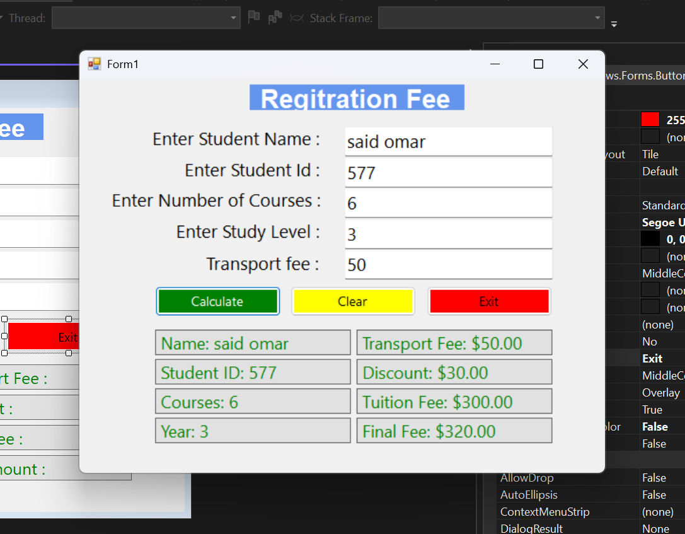

## Qiimaha koorsooyinka
| Study Level | Qiimaha Koorso Kasta |
|---|---:|
| Year1 | $40 |
| Year2 | $45 |
| Year3 | $50 |
| Year4 | $55 |

## Kharashaadka dheeraadka ah
- Accommodation Fee: $120 haddii accommodation la doorto.
- Transport Fee: $50 haddii transport la doorto.

## Discount-ka
- Haddii ardaygu qaato 6 koorso ama ka badan: 10% discount.
- Haddii ardaygu doorto accommodation iyo transport labadaba, isla markaana qaato 5 koorso ama ka badan: 5% service discount oo dheeraad ah.

## Xisaabinta
- Tuition Fee = Course Fee × Number of Courses.
- Accommodation Fee = $120 haddii la doorto, haddii kale $0.
- Transport Fee = $50 haddii la doorto, haddii kale $0.
- Course Discount = Tuition Fee × 10%, haddii tirada koorsooyinku tahay 6 ama ka badan.
- Additional Service Discount = Waxaa la xisaabinayaa haddii ardaygu doorto accommodation iyo transport labadaba, isla markaana qaato ugu yaraan 5 koorso.
- Final Registration Fee = Tuition Fee + Accommodation Fee + Transport Fee − Discounts.

**Fiiro gaar ah:** Assignment-ku ma caddeynayo in discount-yadu laga jaro tuition fee-ga oo keliya ama lacagta guud. Qaacidada kore waxay discount-ka ka xisaabinaysaa tuition fee-ga, waana in habka macallinku rabo la xaqiijiyaa.

## Badhamada
- **Register/Calculate:** Wuxuu hubinayaa xogta ardayga, xisaabinayaa kharashaadka iyo discount-yada, kadibna soo bandhigayaa lacagta ugu dambaysa.
- **Clear:** Wuxuu nadiifinayaa dhammaan xogta iyo natiijada.
- **Exit:** Wuxuu xirayaa barnaamijka.

## Waxyaabaha natiijada lagu muujinayo
- Student Name.
- Study Level.
- Tuition Fee.
- Accommodation Fee.
- Transport Fee.
- Discount.
- Final Registration Fee.

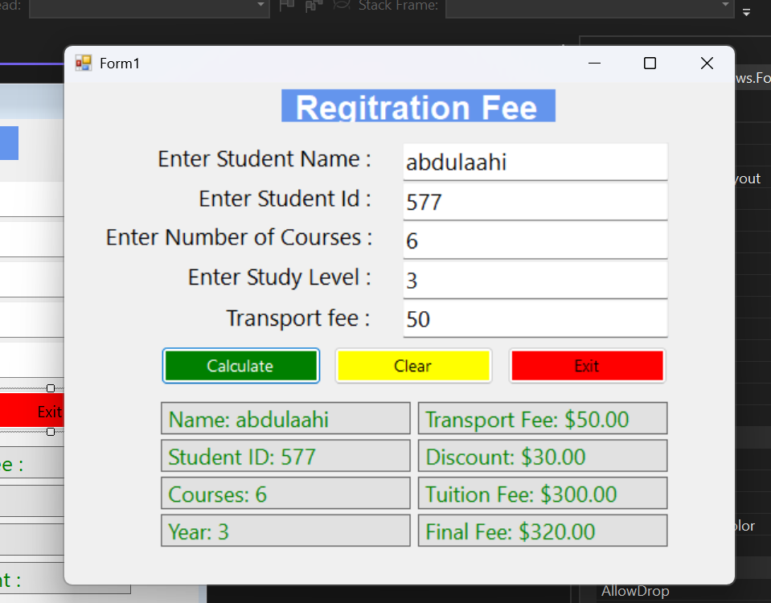

## Waxyaabaha C# ee la adeegsanayo
- Variables iyo data types.
- `TryParse()`.
- `if`, `else if`, iyo `else`.
- `switch` si loo doorto qiimaha koorsada.
- Logical operators.
- CheckBoxes si loo doorto accommodation iyo transport.
- RadioButtons ama ComboBox si loo doorto study level.
- Currency formatting.
- Event handlers.

---

# 5. Guudmar: Waxyaabaha Afarta Assignment ka dhexeeya

Afarta assignment waxay ku dhisan yihiin fikrado muhiim ah oo C# ah.

## Variables iyo Data Types
- `string`: Magacyada iyo aqoonsiyada.
- `int`: Da'da, tirada maalmaha, habeenada iyo koorsooyinka.
- `double` ama `decimal`: Qiimaha lacagta iyo miisaanka.
- `bool`: Xaaladda oggolaanshaha, sida `bookingApproved`.
